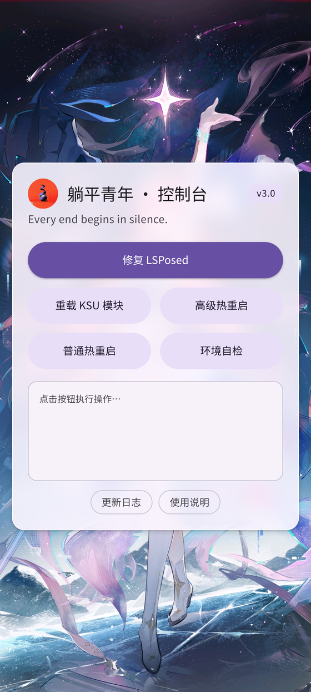
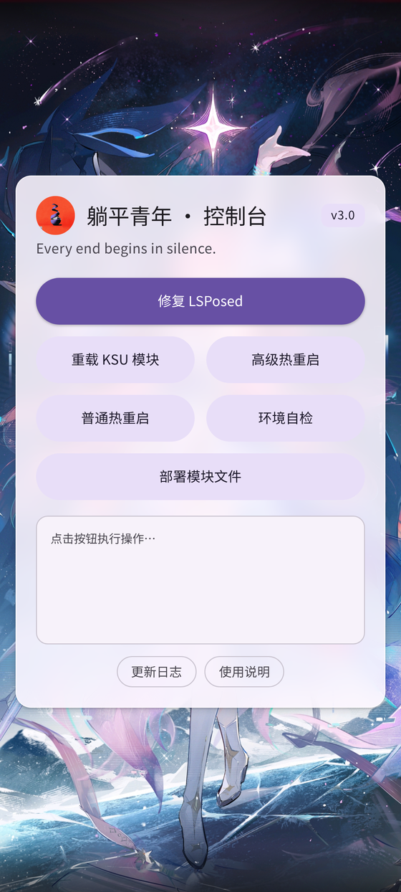

**English** | [简体中文](README_CN.md)

# Lowlife

A KernelSU module designed for temporary root environment.

> **Since v3.0 the whole module is packaged as a standalone APK** — launch it from the home screen, no KernelSU manager WebUI needed.

---



---

## Module Purpose

This module only provides basic environment hiding capabilities for regular detection scenarios.

⚠️ If you encounter detections that this module cannot bypass, you need to combine it with other solutions.

---

## Two Ways To Use It

### 📱 APK (the v3.0 highlight)



`Lowlife-v3.0.apk` is a standalone console app that carries the entire module:

- **Own entry point**: launch "躺平青年" from the home screen, no more digging into the KSU manager
- **Module files built in**: the APK ships `module.prop` / `service.sh` / `customize.sh` / `bin/*.sh` / the whole WebUI,
  and can write them to `/data/adb/modules/Lowlife` with one tap of **"Deploy module files"** —
  handy when the module directory is missing or got overwritten, no zip flashing required
- **Built-in root bridge**: auto-detects KernelSU / Magisk / other `su` implementations and runs module scripts as root
- **Environment self-check**: root state, ksud, module directory and script permissions at a glance
- **Material Design 3 UI, edge-to-edge**: unified colour tokens, shapes and motion, icon-free text buttons,
  background artwork fills the whole screen and insets are avoided automatically (status bar, nav bar, cutout)
- Superuser permission must be granted on first launch

### 🧩 Module (zip)

`Lowlife-v3.0.zip` is still a standard KernelSU module: install it, then open KSU manager → Modules → WebUI.

> The APK and the WebUI **share one single UI and execution logic**; both entry points work side by side.

---

## Operations

### `Repair LSPosed`
Refresh KSU state + choose hot reboot type

### `Reload KSU Modules`
Reload all module lifecycle scripts, no reboot

### `Hot Reboot`
- **Normal Hot Reboot**: No environment hiding after reboot
- **Advanced Hot Reboot**: Automatically apply environment hiding after reboot

### `Deploy module files` (APK only)
Write the module files bundled in the APK to `/data/adb/modules/Lowlife`

### `Environment self-check`
Show root, ksud, module directory and script status

---

## Notes

- It is recommended to execute "Reload KSU Modules" first, then "Repair LSPosed".
- To enable environment hiding, use "Advanced Hot Reboot".
- Hiding effectiveness depends on current system state; if it fails, try re-executing.
- In temporary root environments, a cold reboot will cause root loss.
- The APK needs superuser permission on first launch.

---

## Download

Visit the [Releases](https://github.com/ENDDREAM-ZM/Lowlife/releases) page to download the latest version.

- [Lowlife-v3.0.apk](https://github.com/ENDDREAM-ZM/Lowlife/releases/download/v3.0/Lowlife-v3.0.apk) ← standalone APK
- [Lowlife-v3.0.zip](https://github.com/ENDDREAM-ZM/Lowlife/releases/download/v3.0/Lowlife-v3.0.zip) ← module package
- [Lowlife-v2.0](https://github.com/ENDDREAM-ZM/Lowlife/releases/download/v2.0/Lowlife-v2.0.zip)
- [Lowlife-v1.0](https://github.com/ENDDREAM-ZM/Lowlife/releases/download/v1.0/Lowlife-v1.0.zip)

---

## Changelog

### v3.0
**Highlight: the module is now packaged as an APK**
- New standalone APK "躺平青年" with its own launcher icon — no KernelSU manager WebUI entry required
- The APK bundles all module files (`module.prop` / `service.sh` / `customize.sh` / `bin/*.sh` / `webroot`) and can
  deploy or overwrite them into `/data/adb/modules` in one tap, restoring the module without flashing a zip
- Built-in root execution bridge with automatic detection of KernelSU / Magisk / other `su` environments
- New "Environment self-check" for root, ksud, module directory and script permissions
- APK and KSU WebUI coexist and share the same UI and execution logic
- Command execution now has timeouts and explicit error messages
- Version tag in the UI and clearer log output

### v2.0
- Refactored module file structure
- Added the "Changelog" button
- Relaid out the WebUI buttons
- Split "Hot Reboot" into two standalone buttons and rewrote the executables
- Fixed incomplete environment hiding in "Advanced Hot Reboot"; dropped hiding props that temporary root does not need
- "Repair LSPosed" now offers both normal and advanced hot reboot

### v1.0
- Initial release
- Basic environment hiding / KSU module reload / LSPosed repair
- WebUI console
- "Hot Reboot" with normal and advanced modes

---

## Building

```bash
# Requires JDK 17, Android SDK (platforms;android-34, build-tools;34.0.0), aapt, zipalign

# 1) Generate your own signing key — never commit it
export LOWLIFE_KS_PASS='<set-a-strong-password>'
keytool -genkeypair -keystore ~/lowlife-release.jks \
  -alias lowlife -keyalg RSA -keysize 4096 -validity 10950 \
  -storepass "$LOWLIFE_KS_PASS" -keypass "$LOWLIFE_KS_PASS" \
  -dname "CN=Lowlife, OU=ENDDREAM, O=ENDDREAM, L=CN, ST=CN, C=CN"

# 2) Build
export LOWLIFE_KS=~/lowlife-release.jks
ANDROID_HOME=/path/to/android-sdk bash build.sh
```

Artifacts land in `dist/`: `Lowlife-v3.0.zip` (module) and `Lowlife-v3.0.apk` (standalone app).
APK sources live in [`apk/`](apk/).

> **The signing keystore is NOT stored in this repository** and is listed in `.gitignore`.
> Supply it through `LOWLIFE_KS` / `LOWLIFE_KS_PASS` environment variables.
> Builds you sign yourself will have a different signature from the official APK.

---

## Test Environment

- **Device**: Xiaomi 15 (dada)
- **System**: OS3.0.7.0.WOCCNXM
- **KernelSU**: v3.3.0 (32601-2)

---

## Author

ENDDREAM

---

## 免责声明

> [!NOTE]
> 本模块**所有操作仅在内存中执行**，**不修改任何物理分区**，**不涉及危险操作**。
> 禁用模块或重启设备即可完全恢复原状。

> [!WARNING]
> 本模块**仅限在你本人拥有并完全控制的设备**上使用。
> 严禁用于绕过他人设备的安全检测、家长控制或企业 MDM。

| 风险 | 说明 |
|---|---|
| App 检测 | 银行、支付、游戏类 App 可能检测到环境变化，限制功能甚至封号 |
| 兼容性 | 不同机型 / ROM / KernelSU 版本行为可能不一致 |
| 模块冲突 | 与其它 KernelSU / Magisk 模块可能相互干扰 |
| 系统更新 | OTA 后可能需要重新配置 |

**严禁用途**：绕过**他人设备**的安全检测、家长控制、企业 MDM；作弊、外挂、恶意软件驻留；
规避反作弊与金融风控；任何违法违规用途。

完整条款（含风险表、合规检查清单）见 **[DISCLAIMER.md](DISCLAIMER.md)**。
