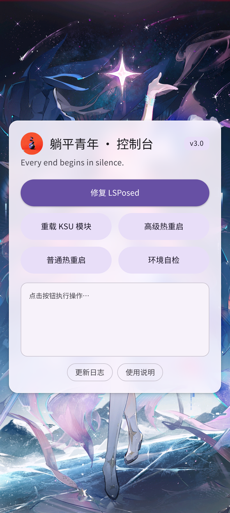
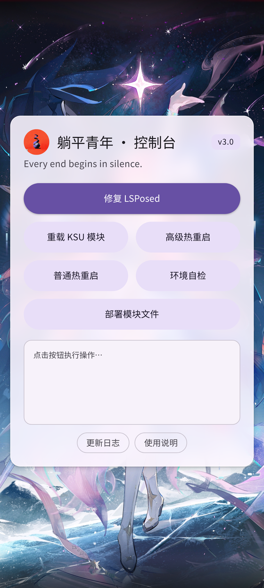

# Lowlife

专为临时 root 环境设计的 KernelSU 辅助模块，提供基础的环境隐藏能力和 LSPosed 修复功能，以及 KernelSU 模块重新挂载。

> **v3.0 起，模块已整体打包为独立 APK** —— 桌面图标直接启动，不再依赖 KernelSU 管理器的 WebUI 入口。

---



---

## 模块用途

本模块仅提供基础的环境隐藏能力，用于应对常规检测场景。

⚠️ 若遇本模块无法解决的检测，需自行配合其他方案解决。

---

## 两种使用形态

### 📱 APK 版（v3.0 重点）



`Lowlife-v3.0.apk` 是一个独立的控制台应用，把整套模块能力装进了一个普通 App 里：

- **独立入口**：桌面图标「躺平青年」，点开即用，不用再进 KSU 管理器找模块页面
- **内置模块文件**：APK 自带 `module.prop` / `service.sh` / `customize.sh` / `bin/*.sh` / WebUI 全套文件，
  可在应用内 **「部署模块文件」** 一键写入 `/data/adb/modules/Lowlife`，
  模块目录丢了、被覆盖了、懒得刷 zip，都能一键拉回来
- **内置 root 执行桥**：自动探测 KernelSU / Magisk / 其他 `su`，以 root 身份调用模块脚本
- **环境自检**：一键查看 root 状态、ksud、模块目录与脚本权限
- **Material Design 3 界面 + 全屏适配**：统一色彩令牌与圆角动效、按钮纯文字无图标、
  背景图铺满整屏并自动避让状态栏/导航栏/刘海
- 首次打开需在 root 管理器中授予超级用户权限

### 🧩 模块版（zip）

`Lowlife-v3.0.zip` 仍是标准的 KernelSU 模块包，安装后在 KSU 管理器 → 模块 → WebUI 中使用。

> APK 与 WebUI **共用同一套界面和执行逻辑**，两种入口同时可用，互不冲突。

---

## 操作说明

### `修复 LSPosed`
刷新 KSU 状态 + 选择热重启类型

### `重载 KSU 模块`
重新加载所有模块生命周期脚本，不重启

### `热重启`
- **普通热重启**：热重启后不进行环境隐藏
- **高级热重启**：热重启后自动进行环境隐藏

### `部署模块文件`（仅 APK）
把 APK 内置的模块文件写入 `/data/adb/modules/Lowlife`

### `环境自检`
查看 root、ksud、模块目录与脚本可执行状态

---

## 注意事项

- 建议先进行“重载 KSU 模块”，然后“修复 LSPosed”。
- 如需隐藏基础环境，点击“高级热重启”。
- 隐藏效果依赖当前系统状态，若失效请尝试重新执行。
- 临时 root 环境下，触发冷重启后会丢失 root 权限。
- APK 首次使用需在 root 管理器中授予超级用户权限。

---

## 下载

前往 [Releases](https://github.com/ENDDREAM-ZM/Lowlife/releases) 下载最新版本。

- [Lowlife-v3.0.apk](https://github.com/ENDDREAM-ZM/Lowlife/releases/download/v3.0/Lowlife-v3.0.apk) ← 独立 APK
- [Lowlife-v3.0.zip](https://github.com/ENDDREAM-ZM/Lowlife/releases/download/v3.0/Lowlife-v3.0.zip) ← 模块包
- [Lowlife-v2.0](https://github.com/ENDDREAM-ZM/Lowlife/releases/download/v2.0/Lowlife-v2.0.zip)
- [Lowlife-v1.0](https://github.com/ENDDREAM-ZM/Lowlife/releases/download/v1.0/Lowlife-v1.0.zip)

---

## 更新日志

### v3.0
**【重点】模块整体打包成 APK**
- 新增独立 APK「躺平青年」，桌面图标直接启动，不再依赖 KernelSU 管理器的 WebUI 入口
- APK 内置整套模块文件（`module.prop` / `service.sh` / `customize.sh` / `bin/*.sh` / `webroot`），
  可在应用内一键部署或覆盖安装到 `/data/adb/modules`，免刷 zip 即可恢复模块
- 新增内置 root 执行桥，自动探测 KernelSU / Magisk / 其他 su 环境
- 新增「环境自检」，一键查看 root、ksud、模块目录与脚本可执行状态
- APK 与 KSU WebUI 双入口并存，共用同一套界面与执行逻辑
- 命令执行增加超时与错误提示，失败原因不再静默
- 界面新增版本标签，日志输出更清晰

### v2.0
- 重构模块文件结构
- 新增“更新日志”按钮
- WebUI 按钮重新布局
- “热重启”拆分为两个独立按钮，并重写了可执行文件
- 修复“高级热重启”隐藏环境不完整的问题，去除临时 root 不需要的隐藏属性
- “LSPosed 修复”添加“普通热重启”和“高级热重启”，可自行选择重启方式

### v1.0
- 初始版本发布
- 支持基础环境隐藏 / KSU 模块重载 / LSPosed 修复
- 支持 WebUI 控制台操作
- “热重启”支持普通 / 高级两种重启模式

---

## 自行构建

```bash
# 环境：JDK 17、Android SDK（platforms;android-34、build-tools;34.0.0）、aapt、zipalign

# 1) 生成你自己的签名密钥（不要提交到仓库）
export LOWLIFE_KS_PASS='<设置一个强密码>'
keytool -genkeypair -keystore ~/lowlife-release.jks \
  -alias lowlife -keyalg RSA -keysize 4096 -validity 10950 \
  -storepass "$LOWLIFE_KS_PASS" -keypass "$LOWLIFE_KS_PASS" \
  -dname "CN=Lowlife, OU=ENDDREAM, O=ENDDREAM, L=CN, ST=CN, C=CN"

# 2) 构建
export LOWLIFE_KS=~/lowlife-release.jks
ANDROID_HOME=/path/to/android-sdk bash build.sh
```

产物输出到 `dist/`：`Lowlife-v3.0.zip`（模块包）与 `Lowlife-v3.0.apk`（独立 APK）。
APK 源码在 [`apk/`](apk/)。

> **签名密钥不存放在本仓库中**，已在 `.gitignore` 里排除。
> 通过环境变量 `LOWLIFE_KS` / `LOWLIFE_KS_PASS` 提供。
> 你自己签出的 APK 与官方包的签名不同，不能覆盖安装。

---

## 测试环境

- **设备**：小米 15 (dada)
- **系统版本**：OS3.0.7.0.WOCCNXM
- **KernelSU**：v3.3.0 (32601-2)

---

## 作者

ENDDREAM

---

## 免责声明

> [!NOTE]
> 本模块**所有操作仅在内存中执行**，**不修改任何物理分区**，**不涉及危险操作**。
> 禁用模块或重启设备即可完全恢复原状。

> [!WARNING]
> 本模块**仅限在你本人拥有并完全控制的设备**上使用。
> 严禁用于绕过他人设备的安全检测、家长控制或企业 MDM。

| 风险 | 说明 |
|---|---|
| App 检测 | 银行、支付、游戏类 App 可能检测到环境变化，限制功能甚至封号 |
| 兼容性 | 不同机型 / ROM / KernelSU 版本行为可能不一致 |
| 模块冲突 | 与其它 KernelSU / Magisk 模块可能相互干扰 |
| 系统更新 | OTA 后可能需要重新配置 |

**严禁用途**：绕过**他人设备**的安全检测、家长控制、企业 MDM；作弊、外挂、恶意软件驻留；
规避反作弊与金融风控；任何违法违规用途。

完整条款（含风险表、合规检查清单）见 **[DISCLAIMER.md](DISCLAIMER.md)**。
